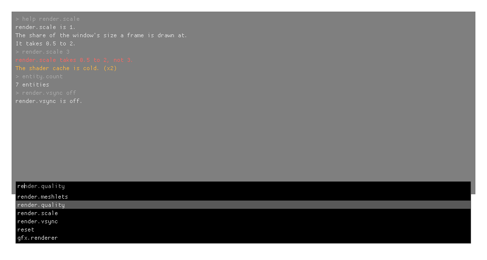
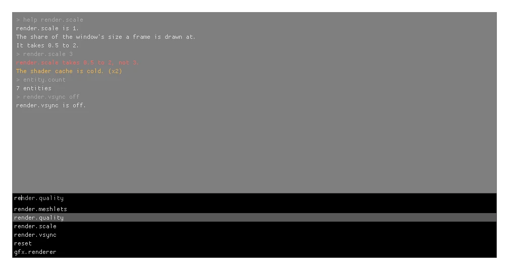
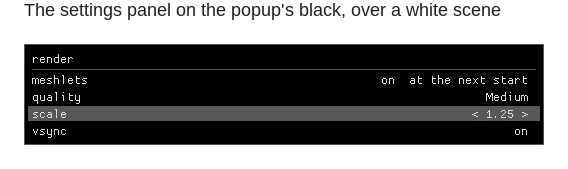

# Diagnostics devlog

What landed in Diagnostics, by day and newest first, with the pictures taken on the way, the
captures the repository keeps under `.github/assets` and the pictures made while an item was built,
kept under `.github/assets/readings` as WebP files named by their day, each on the day its name
says, and the notes written beside them as Markdown files named the same way. A line under Done
names the item of .github/REVIEW.md or .github/REVIEW-ARCHIVE.md and the commit that closed it.

## 2026-11-23

Commits that day

- `2b0299e` A text setting offers its choices from a function asked each time, and a setting can be
  left out of the panel.
- `c8c2694` The settings file keeps the line of a setting a lock refuses, and the README says the
  lock.

## 2026-11-22

The console with its popup of six candidates open below the field, joined to it in one black under
one border and as wide, over the free part of the screen so the log above stays whole, the second
candidate selected and the row for the answer line over the field empty, cut out on a white sheet.

The console with its field running the window's whole width at its foot, flush to the window's edges
with no padding or border round it, the popup of six candidates open below it as wide, in one black,
the answer line's row empty over the field, cut out on a white sheet.

The settings panel on the page of the settings named render on the console popup's opaque black, its
text, selected band and border the popup's, scale at 1.25 selected on the gray band between the
marks of left and right and meshlets saying it takes effect at the next start, over a white sheet
where the old half-alpha ground read as gray, cut out with a title.

Commits that day

- `8c79833` A setting can be locked by a reason its host gives as it is read, which shows its row
  only reading in the panel and refuses a set or a reset with that reason while the settings file
  keeps its line.
- `bcb4513` The open panels give one answer, whether a panel that takes input is open, true for the
  console, the settings panel and a host panel joined as taking input and false for the overlay.
- `a9c9ff4` The settings panel now stands on the console popup's opaque black from the neutral look,
  so it reads over a bright scene.
- `7bef80b` The console opens on F4 and the settings panel on F5 by default, the two keys swapped.
- `fb10049` The console's field runs the window's whole width at its foot, flush to the edges with
  no border over them.
- `918de6e` One panel is open at a time, the overlay, the settings panel, the console and any a host
  joins, held by one state the keys carry.
- `15414b1` The console opens its candidates below the field and keeps a row for the answer line
  above it.
- `10bf95e` The settings file is disposed with a last write, after which it hears no registry event
  and writes nothing.
- `2d4343d` The console wraps its lines at the window's width and has no horizontal scrollbar.
- `c5e1876` The panel draws no marks round the value of a selected row that only reads.
- `4f3cf53` Settings can only read, refuse a value, be unsigned, and keep a player's values in the
  file.
- `d48d664` The field takes the popup's black with it, and the README opens on the two captures.
- `96346c2` The popup of candidates joins the input field, its lower edge on the field's upper edge
  with no gap, the same left and right edges, its text starting where the typed text does and one
  border running round the two, and the console picture is retaken.
- `7d0dce6` The drawn console and panel take the neutral look of the debug overlay, light gray text
  on black at half alpha with no hue and one palette of their own pushed around their drawing,
  warning and error lines keeping theirs, and the two pictures are retaken on a white sheet with a
  title.
- `6bbc4ce` The panel raises Answered with the name of the setting moved or the line of the action
  run and its answer, so a host logs what was moved and the exception of an action that threw.
- `4688279` The console raises LineRun with the line as entered and its answer from Submit and
  Enter, after the echo and the answer are written and with no lock held, so a host logs the
  failures of lines typed into a drawn console, and Enter empties the field before it runs the line.
- `2e95e02` DiagnosticKeys is disposable, taking out only the five settings it added and ending its
  key handling, so a process that makes keys for one app after another adds a new set each time.
- `7f84619` CommandLine.Text gives the rest as one text, with one pair of quotes around the whole
  rest taken off and its escaped quotes and backslashes undone, and the rest as typed where it is no
  such pair.
- `cadf222` The answer of a command that threw carries the exception as Answer.Error for the host to
  log, with its text and its FAILED code as they were, and no other answer carries one.
- `10a18e1` The console takes a stamp function from the host, its frame number, and every line
  carries the stamp of its latest writing as ConsoleLine.Stamp, 0 where there is no function.
- `1675fe2` The console raises LineWritten for each line it keeps, with the line as it stands and
  whether it repeated the one before, on the writing thread after the lock is let go, so a host
  writes every line to its log file.
- `d4d298e` A line a host writes again in a row at Info, Warning or Error is kept once with a count
  and every line carries its number in the stream, an entered line and its answer never collapse,
  and the console shows the count in brackets after the text where it is over one.
- `381fed2` The README binds a host in three named steps with a command that answers late and a
  generator shown from its source to its emission, and the example gains greet.later, which answers
  at once and writes its second line through the console from another thread.

## 2026-11-21

The console as the ImGui library draws it with no device in the neutral look of the overlay, light
gray text on black at half alpha on a host theme that is blue, a plain list of every line with
entered lines dimmed, a refused set in red and a host's warning in amber shown once with its count
after a second writing, the popup of six candidates joined to the field, its lower edge on the
field's upper edge and as wide, the field in the popup's black so the box is one shade, with one
border round both and its text starting where the typed text does, the second selected, the ghost
text nder.quality after the typed re, the window cut out on a white sheet with a title and no empty
strip under the field.

The settings panel in the same neutral look on the page of the settings named render, scale at 1.25
selected on a gray band with its value between the marks of left and right and meshlets saying it
takes effect at the next start, the window cut out on a white sheet with a title.

Commits that day

- `7e9cb2c` The console field takes a line the host sets while it has the keyboard, which it kept
  over the model before, and the lock rule of NORM.md says that a build or test that opens no device
  takes no lock.
- `e6feafc` The console window no longer leaves an empty strip under its field, since the hint takes
  its row only where the line has a hint, and the picture is made again.
- `c3a5403` The console becomes a plain list of every line with a popup of candidates above the
  field, the names that begin with the word and then those at a later dotted part, a selection that
  up and down move, ghost text that Tab fills, and the search field and the level filters leave the
  model and the drawer.
- `5fc659e` The module gains an example, a console program with no window that registers three
  commands and four settings, reads and writes a settings file, runs lines from its arguments or
  standard input through the console's model and prints the answers, with tests that hold its output
  and a pointer to it in the README.
- `da71a5d` The pin of the Tools module moves to its newest commit, which no fact of the module
  changes, and the devlog is written again with its script.
- `539f411` The cheatsheet lists the ImGui library's two types under a heading of their own, written
  by a second call of the writer that a test holds, and the picture of the console and the panel is
  cut to its two windows.
- `be8f4b1` The ImGui library draws the console with its field, history, completion and hint and the
  settings panel steered by ImGui's arrows, Enter, Escape and a pad, and the tests draw both into a
  picture on the CPU with no device.
- `e84bde3` The core gains the overlay's model of named sections, frame times and their statistics,
  the settings panel's model of pages steered by six inputs, a setting's step, and the five keys as
  rebindable settings taken on release and never by a chord.
- `02be0c9` The core gains its registry of commands and settings in one namespace, the line a
  console runs with its quoted words, settings with a range, choices, a value for the next start and
  an environment variable that overrides them, the console's model with history and completion, and
  the settings file that keeps only changed values and unknown names, with the calls safe from any
  thread named in the README.
- `766abdf` The module gains its solution, an empty core library that takes no package, an empty
  library beside it that alone references ImGui, tests that both load, that the core stands on .NET
  alone and keeps the shared checks and that comment lines hold to 100 columns, the version at 0.1
  and a build workflow on Linux, Windows and macOS.
- `999769e` The module gains its documents, AGENTS.md, the README with its link row, STYLE.md,
  COMMITS.md and the code of conduct as the other modules keep them, an empty cheatsheet and devlog,
  the license, git's ignore and attribute files, the Tools module as a submodule, the review and the
  norm.
