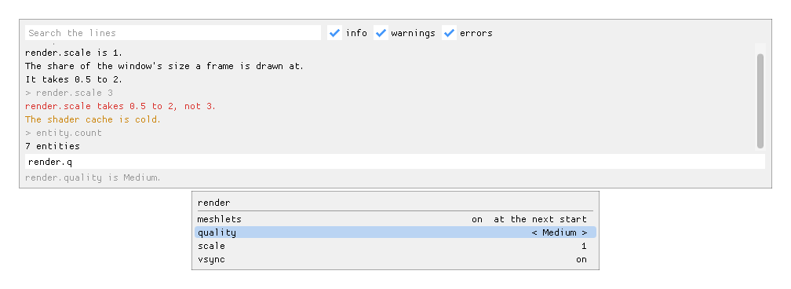

# Diagnostics devlog

What landed in Diagnostics, by day and newest first, with the pictures taken on the way, the
captures the repository keeps under `.github/assets` and the pictures made while an item was built,
kept under `.github/assets/readings` as WebP files named by their day, each on the day its name
says, and the notes written beside them as Markdown files named the same way. A line under Done
names the item of .github/REVIEW.md or .github/REVIEW-ARCHIVE.md and the commit that closed it.

## 2026-11-21

The console and the settings panel as the ImGui library draws them, in ImGui's light style at 960
pixels wide with no device, cut to the two windows and set on a white ground, the console across the
top with entered lines dimmed, a refused set in red, a host's warning in orange and the hint of the
line being entered under the field, and the panel under it on the page of the settings named render,
the selected row banded with its value between the marks of left and right and a setting that waits
for the next start saying so.

Commits that day

- `539f411` The cheatsheet lists the ImGui library's two types under a heading of their own, written
  by a second call of the writer that a test holds, and the picture of the console and the panel is
  cut to its two windows.
- `be8f4b1` The ImGui library draws the console with its field, history, completion and hint and the
  settings panel steered by ImGui's arrows, Enter, Escape and a pad, and the tests draw both into a
  picture on the CPU with no device.
- `e84bde3` The core gains the overlay's model of named sections, frame times and their statistics,
  the settings panel's model of pages steered by six inputs, a setting's step, and the five keys as
  rebindable settings taken on release and never by a chord.
- `02be0c9` The core gains its registry of commands and settings in one namespace, the line a
  console runs with its quoted words, settings with a range, choices, a value for the next start and
  an environment variable that overrides them, the console's model with history and completion, and
  the settings file that keeps only changed values and unknown names, with the calls safe from any
  thread named in the README.
- `766abdf` The module gains its solution, an empty core library that takes no package, an empty
  library beside it that alone references ImGui, tests that both load, that the core stands on .NET
  alone and keeps the shared checks and that comment lines hold to 100 columns, the version at 0.1
  and a build workflow on Linux, Windows and macOS.
- `999769e` The module gains its documents, AGENTS.md, the README with its link row, STYLE.md,
  COMMITS.md and the code of conduct as the other modules keep them, an empty cheatsheet and devlog,
  the license, git's ignore and attribute files, the Tools module as a submodule, the review and the
  norm.
