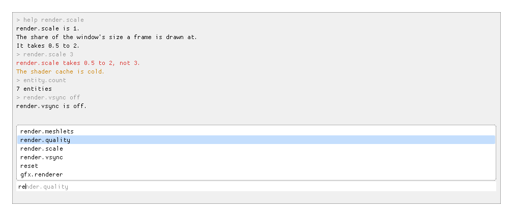
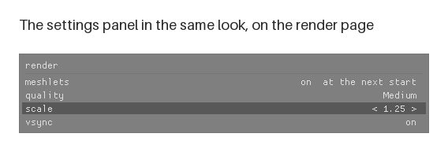

[Devlog](https://github.com/EggyStudio/3DEngine.Diagnostics/blob/main/DEVLOG.md) [Cheatsheet](https://github.com/EggyStudio/3DEngine.Diagnostics/blob/main/CHEATSHEET.md)

# Diagnostics

Diagnostics is a library an engine takes as a git submodule, for what a developer and a player
reach at the keyboard, console commands and settings in one registry, and the content of the
console, the debug overlay and the settings panel as plain data a host draws. It references no
engine, and an engine binds it by filling the hooks it declares and drawing what it gives.

The core, `3DEngine.Diagnostics`, stands on .NET alone with no package and no graphics reference,
which a test of its own holds. `3DEngine.Diagnostics.ImGui` beside it is the one project that
references Dear ImGui and draws the console and the settings panel, for a host that has an ImGui
context. The overlay is drawn by the host from its model, with whatever text the host draws.

## What it holds

| Type | Gives |
|---|---|
| `Registry` | The commands and the settings of a process by name in one namespace, a name added twice refused, and `Run`, which runs a line as a command or as the reading or setting of a setting, with `help`, `list` and `reset` of its own |
| `Command` and `Argument` | A console command, its dotted name, summary, usage, the words it takes and what runs it |
| `CommandLine` | A line as a console takes it, its name, the rest as typed and its words, split at blanks with a quoted word kept whole |
| `Answer` | What a line answers, its text and, where it failed, a code in capitals a script reads |
| `CommandAttribute` | The mark a host's generator reads on a static method to add it as a command |
| `Setting` and `Setting<T>` | A setting of a bool, an int, a float, a double, an enum or a string, its default, its range or choices, the host's getter and setter, whether it takes effect at the next start, and the environment variable that overrides it |
| `SettingKind` | Whether a setting is a toggle, a whole number, a number, a choice or text |
| `ConsoleModel` | A console's content with no drawing, a plain list of every line written, the line being entered with the candidates its start leaves, their selection and the ghost text, a line in and lines out, the history and a hint |
| `ConsoleLine` and `ConsoleLevel` | A line a console shows and whether it was entered, plain, a warning or an error, which a drawer colors it by |
| `OverlayModel`, `OverlayPlace` and `FrameStats` | The debug overlay's content with no drawing, named sections of lines a host fills in four places, asked four times a second, the last 240 frames' times and their statistics, the last, the average and the 1% low |
| `PanelModel`, `PanelPage`, `PanelRow`, `PanelRowKind` and `PanelInput` | The settings panel's content with no drawing, a page for each first word of the settings' names and a host's own pages of settings, actions and text, steered by up, down, left, right, accept and back |
| `DiagnosticKeys` and `KeyAction` | The five keys as text settings a player rebinds, F1 hiding the interface, F2 asking for a screenshot, F3 the overlay, F4 the panel and F5 the console, each taken on its key's release and never by a chord |
| `ImGuiConsole` and `ImGuiPanel` | In `3DEngine.Diagnostics.ImGui`, the console and the settings panel drawn with Dear ImGui in a host's frame, the console's field with history, completion and a hint, the panel steered by ImGui's arrows, Enter, Escape and a pad |
| `SettingsFile` | The settings kept across runs in one text file of name and value lines, only the values that differ from their defaults, with unknown names kept |

## Taking it into an engine

An engine adds the repository as a git submodule under `modules/` and references the core's
project, and the second project where it draws with ImGui, here from a project one folder below the
engine's root.

```bash
git submodule add https://github.com/EggyStudio/3DEngine.Diagnostics.git modules/Diagnostics
```

```xml
<ProjectReference Include="..\modules\Diagnostics\Diagnostics\Diagnostics.csproj" />
<ProjectReference Include="..\modules\Diagnostics\Diagnostics.ImGui\Diagnostics.ImGui.csproj" />
```

The projects build the assemblies `3DEngine.Diagnostics` and `3DEngine.Diagnostics.ImGui`, whose
types are in the one namespace `Diagnostics`. The second takes the package
`Twizzle.ImGui-Bundle.NET` at 1.91.5.2, whose calls are in the namespace `ImGuiNET`, and a host
draws with it into the context it made with the same package.

A clone of the engine fetches the module with `git clone --recurse-submodules`, or with
`git submodule update --init` in a clone made without it, and a workflow checks it out with
`submodules: true` on `actions/checkout`. A change the engine uses is committed and pushed here
before the engine's commit that moves its pointer, so the engine's history never names a commit
this repository does not have.

## Binding it in your engine

The module opens no window, reads no key and draws nothing in its core, so a binding is the host's
code that adds its commands and settings, hands lines over and draws the models its own way. `host`
stands for the engine's own calls, whatever it names them.

A binding is three steps, each of which stands without the ones after it. The registry and the
commands come first, added by hand or by a generator that reads `CommandAttribute`, and with them a
host can run a line. The console, the overlay's sections and the keys come second, and the settings
with the panel and the settings file third. The block below holds the registry, the console, the
file and a line run, and the section after it the overlay, the panel and the keys.

```csharp
// Once, as the host starts, on any thread.
// The console comes first, for a command to write to.
var registry = Registry.Process;
var console = new ConsoleModel(registry);
registry.Add(new Command("screen.shot", "Writes a picture of the frame.", "screen.shot [<path>]",
    line => new Answer(host.Screenshot(line.Words.Count > 0 ? line.Words[0] : null))));
registry.Add(new Command("scene.load", "Loads a scene in the background.", "scene.load <path>",
    line =>
    {
        if (line.Words.Count != 1) return Answer.Fail(Answer.BadArgument, "scene.load takes a path.");
        host.LoadInBackground(line.Words[0], done: text => console.Write(ConsoleLevel.Info, text));
        return new Answer($"Loading {line.Words[0]}.");
    })
{
    Arguments = [new("path", "path")],
});
registry.Add(new Setting<bool>("render.vsync", "Whether a frame waits for the display.", true,
    host.GetVsync, host.SetVsync) { EnvironmentVariable = "GAME_VSYNC" });

// Once the settings are added, on the host's thread.
// The file's values go through the setters and a refused line comes back as text.
var file = new SettingsFile(host.SettingsPath);
foreach (var refusal in file.Read(registry)) host.Log(refusal);

// From any thread, a line of the host's log or a command's late answer.
console.Write(ConsoleLevel.Warning, "The shader cache is cold.");

// On the host's thread, a line the player entered or a socket handed over.
var answer = console.Submit("render.vsync off");
if (!answer.Done) host.Log($"{answer.Code} {answer.Text}");

// As the player leaves the settings and as the program ends.
file.Write(registry);
```

`Diagnostics.Example` is a console program with no window that binds the core this way, four
commands of which `greet.later` answers late through `ConsoleModel.Write`, four settings of four
kinds, a settings file read at the start and written at the end, and lines from its arguments or
standard input run through a `ConsoleModel`. A test of the module runs it with scripts of lines and
holds its output.

```bash
dotnet run --project Diagnostics.Example -- "greet.hello" "greet.style shout" "greet.hello Ada"
```

It stands on these conventions.

- A name is lowercase words of letters, digits and underscores joined by dots, as `render.vsync`,
  and commands and settings share the one namespace, so a line's first word is one or the other.
  `render.vsync` alone answers with the setting and `render.vsync off` sets it.
- `Registry.Add`, `Registry.Remove`, the finding and listing calls, `ConsoleModel.Write` and
  `ConsoleModel.Lines` are safe from any thread. `Registry.Run`, `ConsoleModel.Submit`, a setting's
  set and the settings file are the host's thread's, since a command and a setter run where they are
  called. A host that takes lines from a socket hands each to its own thread before it runs.
- A command returns its answer at once. Where its work is not done by then it returns a sentence
  that says so and writes the result with `ConsoleModel.Write` when the work ends, from whatever
  thread, as `scene.load` does above. That line stands at the end of the console, below whatever
  was written since, not under the line that asked, and it carries no code, so a failure is written
  at `ConsoleLevel.Error`. A command reads the settings it needs before it hands the work to
  another thread, since a setting's value is the host's thread's.
- A failure's code is capitals with underscores. The module's own are `NO_SUCH_COMMAND`,
  `BAD_ARGUMENT`, `OUT_OF_RANGE` and `FAILED`, and a host's command gives its own through
  `Answer.Fail`.
- A value is text in the invariant culture, a toggle `on` or `off`, a choice an enum's name read
  whatever its case, and a text in double quotes where it holds a blank.
- A setting with `AtNextStart` keeps the set value for the file and its running value until the
  program starts again, and `SettingsFile.Read` gives it the file's value as the running one.
- A setting's environment variable, where it is set to a value the setting takes, gives the running
  value for the whole run. A set is then kept for the file alone, and `Setting.Overridden`, the
  setting's sentence and `list` say so.
- `SettingsFile.For` names a game's file, `settings.txt` in a folder of the game's name under the
  system's folder of applications' data, and a host with a folder of its own gives any path.

### The overlay, the panel and the keys

A host that shows the overlay and the panel makes the three models once, gives the keys every key
that goes down and comes up by the host's own name for it, and draws what the models hold while
they are shown.

```csharp
var overlay = new OverlayModel();
overlay.AddSection("scene", OverlayPlace.Left, () => [$"entities {host.Entities}"]);
overlay.AddSection("passes", OverlayPlace.Right, host.PassTimings, detail: true);
var panel = new PanelModel(registry);
panel.Root.AddAction("Quit", "game.quit");
var keys = new DiagnosticKeys(registry) { Overlay = overlay, Panel = panel, Console = console };
keys.ScreenshotAsked += host.Screenshot;

// Each frame, with the frame's time in seconds.
overlay.Frame(host.FrameSeconds);
foreach (var key in host.KeysPressed) keys.KeyDown(key, host.FieldIsTyping);
foreach (var key in host.KeysReleased) keys.KeyUp(key);
if (panel.Open && host.Pressed("Down")) panel.Press(PanelInput.Down);
```

- An action is taken as its key comes up where no other key went down or was held meanwhile, so a
  chord holding one of the five keys stays the program's. A key whose name holds `Shift` is no
  other key, and Shift with the overlay's key turns the overlay's detail over.
- The screenshot is the host's. The keys raise `DiagnosticKeys.ScreenshotAsked`, and the host
  reads `DiagnosticKeys.InterfaceHidden` before it draws its interface.
- The overlay holds one line of its own, the frame's rate and statistics at the head. Every other
  number is a section's the host adds, drawn in the section's place, `OverlayPlace.Head` and
  `OverlayPlace.Beside` on the first rows and `OverlayPlace.Left` and `OverlayPlace.Right` as two
  columns under them, with `OverlayModel.FrameTimes` as a strip of the last 240 frames in
  milliseconds.
- The panel takes six inputs and repeats none, so a held key or stick is repeated by the host. A
  row is drawn from `PanelRow`, its label, its value and its marks for a value that waits for the
  next start and one the environment overrides.
- The overlay, the panel and the keys are the host's thread's.

### Drawing with ImGui

A host that draws with Dear ImGui references the second project and makes the two drawers once.
Each draws nothing while its model is closed, sets no style and no font, and is called between the
host's `NewFrame` and `Render` with the window's size in ImGui's units.

```csharp
var drawnConsole = new ImGuiConsole(console);
var drawnPanel = new ImGuiPanel(panel);

// Each frame, inside the host's ImGui frame.
drawnConsole.Draw(host.WindowSize);
drawnPanel.Draw(host.WindowSize);
foreach (var key in host.KeysPressed) keys.KeyDown(key, typing: drawnConsole.Typing);
```



- The console is a window across the top, `ImGuiConsole.Height` of the host's window, 0.4 by
  default, holding a plain list of every line, colored by the line's level, the field and the hint
  under it. Its field takes the keyboard as the console opens.
- The popup of candidates stands above the field once the player edited, as wide as the field, six
  rows at most with the selected one banded, and the ghost text follows what is typed, dimmed, where
  the selected candidate begins with the word being typed. Up and down move the selection while the
  popup shows and walk the history otherwise, Tab fills the selected candidate and Enter runs the
  line. `ImGuiConsole.Typing` says whether the field has the keyboard, which the host gives
  `DiagnosticKeys.KeyDown`. The box and the ghost are drawn on ImGui's foreground list, so they
  stand over the console whichever window has the focus.
- The candidates are the names of commands and settings that begin with the word and then those
  with a later dotted part that does, so `vsync` offers `render.vsync` and Tab fills it. After a
  setting's name they are its choices.



- The panel is a window in the middle, sized to its rows, which ImGui measures in the first frame
  and draws from the second. With `ImGuiPanel.ReadsKeys`, the default, it reads the arrows, Enter
  and Escape and a pad's directions, lower face button and right face button from ImGui's keys, so
  a host that feeds ImGui its input feeds the panel, a pad's where the host's backend sets
  `ImGuiBackendFlags.HasGamepad`. A host that steers the model itself turns it off.
- A host without ImGui draws the same models its own way, for the console `ConsoleModel.Lines`,
  `ConsoleModel.Typed`, `ConsoleModel.PopupShown`, `ConsoleModel.Candidates` with
  `ConsoleModel.SelectedIndex` and `ConsoleModel.FirstVisible`, `ConsoleModel.Ghost` and
  `ConsoleModel.Hint`, feeding `ConsoleModel.Edit`, `ConsoleModel.Navigate`,
  `ConsoleModel.Accept` and `ConsoleModel.Enter`, and for the panel `PanelModel.Title` and
  `PanelModel.Rows`.

### What a generator emits

The module reads no attribute itself. A host whose commands are static methods marked with
`CommandAttribute` keeps the generator that finds them, and for each method it emits one call that
adds a `Command` to `Registry.Process` as the assembly loads, from a module initializer, which is
safe since adding is safe from any thread. The usage is written from the method's parameters, and
the run reads them from the line's words and answers with the text the method returns or with
`Answer.Fail` and the host's code.

```csharp
// What the author writes.
public static class Commands
{
    [Command("entity.move", "Moves an entity.")]
    public static string Move(int id, float x, float y, float z) => scene.Move(id, x, y, z);
}

// What the generator emits for it.
Registry.Process.Add(new Command("entity.move", "Moves an entity.", "entity.move <id> <x> <y> <z>",
    line => line.Words.Count == 4
        && int.TryParse(line.Words[0], out var id)
        && float.TryParse(line.Words[1], CultureInfo.InvariantCulture, out var x)
        && float.TryParse(line.Words[2], CultureInfo.InvariantCulture, out var y)
        && float.TryParse(line.Words[3], CultureInfo.InvariantCulture, out var z)
            ? new Answer(Commands.Move(id, x, y, z))
            : Answer.Fail(Answer.BadArgument, "entity.move takes an id and three numbers."))
{
    Arguments = [new("id", "int"), new("x", "float"), new("y", "float"), new("z", "float")],
});
```

An argument's kind is the host's own word for what the word is. Only `name` means something to the
module, a command's or a setting's name that the console completes, and a parameter that has a
default is an argument with `Optional` set, which the usage shows in brackets.

A command that takes its line whole, as a fragment of code or a path with blanks, declares one
argument with `TakesLine` and reads `CommandLine.Rest`.

## Building and testing

The tests take the checks every module keeps from the Tools module, a git submodule under
`modules/Tools`, so a clone fetches it with `git clone --recurse-submodules`, or with
`git submodule update --init` in a clone made without it. With the .NET 10 SDK:

```bash
dotnet build Diagnostics.slnx
dotnet test Diagnostics.Tests
```

## License

The Mozilla Public License 2.0, in [LICENSE](LICENSE).
